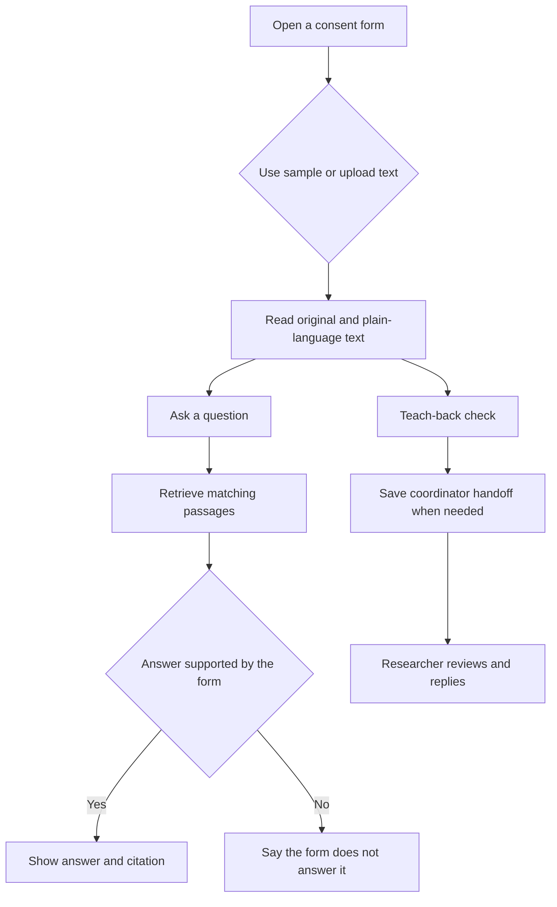

# Aetheria

Aetheria is a working prototype for reading clinical research documents with more context and less guesswork. It puts the original consent text beside a shorter explanation, lets a participant ask questions about the document, and gives the study team a place to review handoffs and check wording.

The application is a demo. It does not provide medical advice, collect an informed-consent signature, approve a protocol, or decide whether someone understands a study. A person on the study team still makes those decisions.

The included AETHER-01 consent, product, and clinic are fictional. The repository also contains a stored copy of public material for NCT03238781 for the research workspace. The public trial material is kept separate from the practice consent.

## What it does

Participants can:

- Upload a text-based PDF, `.txt`, or `.md` consent form, or open the included sample
- Read a short explanation beside the original language
- Ask questions and see the supporting passage
- Complete a teach-back check and save questions for the study coordinator
- Review saved questions and study progress in one place
- Switch the interface among English, Spanish, French, and Simplified Chinese

Researchers can:

- Review participant handoffs and reply to follow-up messages
- Compare the practice consent with a protocol
- Review plain-language readings for different audiences
- Check figures, source passages, wording conflicts, and version history
- Run the built-in test lab and work with the stored public-trial materials

## Architecture

```mermaid
flowchart LR
  P[Participant browser] --> W[React and Vite application]
  R[Researcher browser] --> W
  W --> S[Session storage]
  W --> B[FastAPI service]
  B --> D[(SQLite database)]
  W --> G[Gemini relay when configured]
  W --> O[Local Ollama when running]
  W --> F[Consent text and bundled study files]

  F --> W
  G --> W
  O --> W
  D --> B
```



The React application owns the reading, comparison, and local document workflows. The FastAPI service handles accounts, signed session tokens, teach-back handoffs, and follow-up messages. SQLite is the default local store. The optional model providers only receive the passages needed for a question or translation request.

## Participant flow



## Project layout

```text
src/
  pages/          Route-level participant, research, and account screens
  components/     Shared interface pieces and document panels
  scene/          Three.js and canvas visuals used by the landing and account pages
  lib/            Consent parsing, retrieval, checks, language support, and tests
  data/           Included sample documents and study fixtures
  state/          Session and role state
backend/
  main.py         FastAPI routes, authentication, handoffs, and SQLite access
  schema.sql      Reference database schema
server/
  gemini-relay.ts Dev-server relay for the optional Gemini provider
public/
  trials/         Stored public-trial materials used by the research workspace
```

## Run locally

Install the backend dependencies once:

```bash
python3 -m venv backend/.venv
backend/.venv/bin/pip install -r backend/requirements.txt
cp backend/.env.example backend/.env
```

Set a real `JWT_SECRET` and `RESEARCHER_REGISTRATION_KEY` in `backend/.env`, then install and run the application:

```bash
npm install
npm run dev:all
```

`npm run dev:all` starts FastAPI and Vite together. Vite prints the local URL. `GET /api/health` confirms that the API is available.

Use `npm run dev` when you only need the frontend. Account registration and researcher handoffs need the FastAPI service.

## Configuration and security

`backend/.env` is ignored by Git. It contains local backend settings:

```dotenv
APP_ENV=development
CORS_ORIGINS=http://localhost:5173
DATABASE_URL=sqlite:///./aetheria.db
JWT_SECRET=use-a-long-random-value
RESEARCHER_REGISTRATION_KEY=keep-this-private
```

For production, set `APP_ENV=production` and provide a real `JWT_SECRET`. The backend refuses to start in production without it. Set `CORS_ORIGINS` to the deployed frontend origins, separated by commas. Do not use `*` when credentials are enabled.

The optional Gemini key belongs in `.env.local` or in the encrypted `.env.team` workflow. Never put it in a `VITE_` variable because Vite exposes those values to the browser bundle.

```dotenv
GEMINI_API_KEY=your-key
GEMINI_MODEL=gemini-3.5-flash,gemini-3-flash-preview
```

If no provider is configured, document reading and the rule-based checks still work. Ollama is optional for local retrieval:

```bash
ollama serve
ollama pull llama3.2:3b
```

## Quality checks

```bash
npm test
npm run build
npm run demo
```

`npm run build` type-checks and creates a production bundle. `npm test` runs the unit suite. `npm run demo` runs the scripted workflow checks.

The PDF test suite needs the repository dependencies to resolve from the active checkout. If Vite reports a denied `pdfjs-dist` path from a different checkout, reinstall dependencies in the current worktree before treating it as a product failure.

## Deploying the frontend

A Vercel deployment can host the Vite frontend. The FastAPI service and SQLite database do not run inside a static Vercel deployment, so account registration, sign-in, saved handoffs, and messages need a separately deployed API and durable database before a public release.

Before deployment:

1. Build the frontend with `npm run build`.
2. Deploy the FastAPI service to a server or serverless runtime with a persistent database.
3. Set the API service to production mode with a strong `JWT_SECRET`.
4. Set `CORS_ORIGINS` to the public frontend URL.
5. Configure the frontend to send `/api` traffic to the deployed API, or place both behind the same reverse proxy.
6. Add the optional Gemini key only to server-side configuration.

## Data handling

The browser keeps reading state and saved questions in session storage. The local API stores accounts, handoffs, and messages in SQLite. Uploaded document text is processed in the browser for the normal workflow. When Gemini or Ollama is enabled, the application sends only the passages needed for that request. Voice audio is not stored by this project.

## Limits

- Scanned PDFs without a usable text layer are rejected.
- DOCX files are not supported.
- Translation output is marked as machine generated and still needs human review.
- The app does not make enrollment, treatment, safety, or protocol-approval decisions.
- The public-trial fixture is a stored copy, not a live ClinicalTrials.gov connection.

## License and contributions

This repository is a project prototype. Keep secrets out of commits, write tests for behavior changes, and run the build before opening a pull request.
